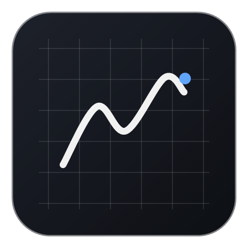

<p align="center">
  
</p>

<h1 align="center">Blackboard</h1>

---

<p align="center">
  A cross-platform, minimal dark glossy desktop blackboard application designed for distraction-free sketching, brainstorming, and visual note-taking.
</p>

<p align="center">
  Chalk-like responsiveness, smart vector shapes & arrows, rich typography, direct image imports, and tactile glassmorphic docks. Includes auto-save snapshots, always-on-top mode, and instant <code>.blackboard</code> file associations.
</p>

<p align="center">
  
  
  
  
</p>

<p align="center">
  
  
  
  
  
</p>

---

## 🌟 Highlights & Features

### 1. Minimal Dark Glossy Aesthetic
- **Chalkboard Surface**: Dark slate canvas (`#16171a` / `#17181c`) with subtle specular gloss reflection.
- **Pattern Backgrounds**: Seamlessly cycle between **Blank**, **Grid**, and **Dotted** patterns via the dock button (`SquareTool.png`, `GridTool.png`, `dottedTool.png`).
- **Glassmorphic Docks & Popovers**: Polished translucent panels with subtle inner highlights and drop shadows.

### 2. Docks & Navigation (Guide Pages 1–2, 11)
- **Left Dock**: Open File / Load Board (`FolderIcon.png`), New Board (`FileTool.png`), and Settings (`SetingsTool.png`).
- **Center Toolbar**:
  - Mode Switch: **View Mode** (`ViewIcon.png`) vs **Edit Mode** (`EditTool.png`).
  - History: Multi-level **Undo** (`UndoTool.png`) & **Redo** (`RedoTool.png`).
  - Vector Tools: **Select** (`SelectTool.png`), **Pen** (`PenTool.png`), **Shape** (`ShapeTool.png`), **Image** (`ImageTool.png`), **Text** (`TextTool.png`), and **Line / Arrow** (`LineTool.png`).
  - Pattern cycle button.
- **Right Dock**: Zoom In (`PlusIcon.png`), Zoom Out (`MinusIcon.png`), and direct reset zoom to 100%.
- **Hide Tile Feature** (Page 11): Click the chevron underneath any dock (`arrowUp.png` / `Arrowdown.png`) to collapse it into a minimal pill, keeping your drawing area completely unobstructed.

### 3. Tool Popovers (Pages 4–10)
- **Text Tool Popover**: Color wheel circle, font size adjuster (default 12), Italics (`ItalicIcon.png` / `ItalicIconFILL.png`), Bold (`BoldIcon.png` / `BoldIconFILL.png`), and Strikethrough (`StrikethroughIcon.png` / `StrikethroughIconFILL.png`).
- **Shape Tool Popover**: Square / Rectangle, Circle, Triangle, Rounded Rectangle, Star, Heart, and Arrow.
- **Pen & Line Tool Popovers**: Color wheel circle, Stroke Weight (`StrokeWeightIcon.png`, default 12), and Transparency (`TransparencyIcon.png`, default 100%).

### 4. Custom Glossy Color Wheel Modal
- Built based on the reference design:
  - **Dual Swatches**: Primary & secondary colors with instant ⇄ swap button and B/W reset.
  - **Color Wheel Canvas**: 360° Hue circumference and radial Saturation gradient with interactive picker ring.
  - **Value / Luminance Slider**: Control brightness from jet black to vivid color to bright white.
  - **"More >>" Expandable Panel**: Precision HEX input and numeric R, G, B channel controls.
  - **Palette Swatches**: 20 preset grayscale and vivid rainbow swatches, plus "+ Add Custom" swatch button.

### 5. Settings Modal (5 Slots - Guide Page 3)
1. **Export Defaults & Asset Rendering**:
   - Default format: PNG, SVG, or PDF.
   - Transparent background toggle.
   - Resolution multiplier (1x, 2x Retina, 3x).
   - Framing: "Crop to Content" vs "Full Visible Frame".
   - One-click "Quick Export Now" button.
2. **Performance & Rendering Fidelity**:
   - Hardware acceleration toggle.
   - Frame rate limiter: 30 FPS, 60 FPS, or Uncapped.
   - Large-image downsampling toggle.
   - Low-power / battery saver mode toggle.
3. **Version History & Offline Cache Management**:
   - Auto-save frequency (30s, 1m, 5m, Off).
   - Automatic milestone snapshots (Hourly, On session close).
   - Live cache storage usage display & "Clear Offline Cache" button.
   - Conflict resolution preference (Keep Local, Keep Remote, Ask).
   - Snapshot browser with one-click rollback.
4. **Auto-Shape & Stroke Recognition (Ink-to-Shape)**:
   - Stroke geometric analyzer converts rough loops into crisp circles, polygons into rectangles, triangles, and scribbles into snapped lines or arrows.
   - "Convert to Shape" delay slider (200ms – 1500ms).
   - Arrow & connector auto-snapping toggle.
   - Ink-to-text recognition toggle.
5. **Pin / Sit on Top**:
   - Purpose: Keeps the app window pinned above other tabs and apps when multitasking.
   - Native Electron `win.setAlwaysOnTop(true/false)` integration with status feedback.

---

## 🚀 Running the App

### Launch Desktop App (Electron)
```bash
npm start
```
or:
```bash
npm run electron:start
```

### Run with Live Dev Server
```bash
npm run electron:dev
```

### Build for Production
```bash
npm run build
```
Cross-platform compatible with **Windows**, **macOS**, and **Linux**.
